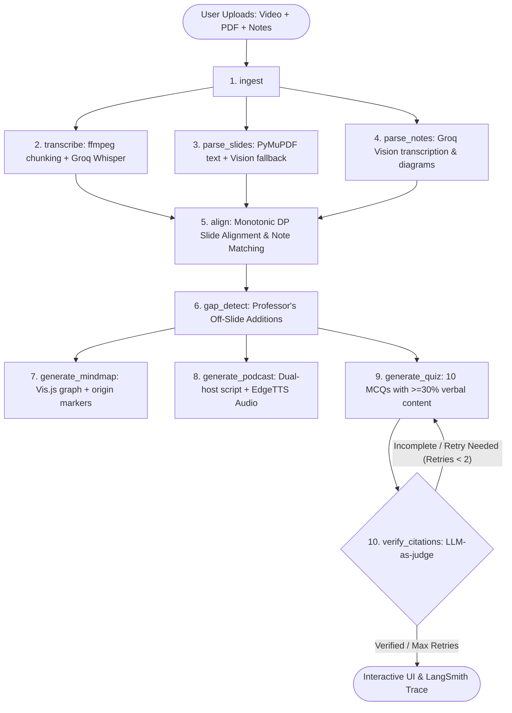

# Beyond the slides
> **Multimodal AI Agent for University Students**: Aligns lecture video, presentation slides, and handwritten notes onto one master timeline, identifies what the professor said that is **NOT** on the slides (verbal gaps), and produces an interactive mind map, a dual-host podcast recap, and citation-verified quiz questions linked to exact video timestamps.

---

# Key Features

1. **Triple-Modality Temporal Alignment**:
   - Synchronizes lecture video, PDF slides, and photos of student handwritten notes into a **Unified Master Timeline**.
   - Solves monotonic dynamic programming (DP) alignment to ensure slides advance chronologically without backward time-warping.
2. **Verbal-Only Knowledge Gap Detection**:
   - Detects professor's verbal additions omitted from the slides: practical examples, edge-case caveats, typo corrections, and crucial exam hints.
   - Categorizes every gap with exact timestamps and one-line summaries.
3. **Interactive Hierarchical Mind Map**:
   - Visualizes concept trees with color-coded origin badges (`slide-only`, `verbal-only`, `both`).
   - Clickable nodes with instant video seeking.
4. **Dual-Host Podcast Audio Recap**:
   - Two personas: **Alex (Host)** covering slide theory and **Sam (Curious Student)** spotlighting off-slide verbal insights and caveats.
   - High-fidelity speech synthesis via the pluggable `EdgeTTS` engine.
5. **Verified 10-Question Quiz**:
   - At least 30% ($\ge 3$ questions) testing professor's verbal-only additions.
   - Every answer backed by verbatim transcript citations $\{start, end, quote\}$.
   - **LLM-as-Judge Verification**: Validates citation authenticity with automated retry loops (up to 2 retries).
6. **High-Contrast White & Bluish UI**:
   - Clean, modern aesthetics with synchronized embedded video player and click-to-seek timestamp pills.
   - Thumbs up/down feedback on every artifact logged directly to **LangSmith**.

---

##  10-Node LangGraph Architecture



---

##  Technology Stack

| Layer | Component | Notes |
|---|---|---|
| **Orchestration** | `LangGraph` | 10 explicit pipeline stages with conditional retry edge |
| **Inference** | `Groq API` | Dynamic models for LLM, Vision, and Whisper STT |
| **Observability** | `LangSmith` | Span tracing, run metadata, feedback capture, and evals |
| **Audio / Video** | `ffmpeg` & `imageio-ffmpeg` | Audio extraction, chunking, and frame sampling |
| **PDF Extraction** | `PyMuPDF` (`fitz`) | High-speed text parsing + pixmap rendering |
| **Embeddings** | `sentence-transformers` | Local `all-MiniLM-L6-v2` for cosine similarity alignment |
| **Speech Synthesis**| Pluggable `EdgeTTS` | Dual neural voices (`en-US-GuyNeural`, `en-US-JennyNeural`) |
| **User Interface** | `Streamlit` | Custom White & Bluish theme with embedded video player |

---

##  Quickstart & Setup

### 1. Prerequisites
- Python 3.11
- Git

### 2. Installation
Clone the repository and install dependencies:
```bash
git clone https://github.com/your-username/Lecture-to-Living-Course.git
cd ReLect
python -m pip install -r requirements.txt
```

*(Note: `imageio-ffmpeg` provides an automatic bundled ffmpeg executable if system ffmpeg is not in your PATH).*

### 3. Configure Environment Variables
Create a `.env` file in the project root (see `.env.example`):
```env
# Groq API Credentials
GROQ_API_KEY=your_groq_api_key_here

# Groq Model Names (Configurable, never hardcoded in source code)
GROQ_STT_MODEL=whisper-large-v3
GROQ_LLM_MODEL=llama-3.3-70b-versatile
GROQ_VISION_MODEL=llama-3.2-11b-vision-preview

# LangSmith Tracing & Evaluation Configuration
LANGSMITH_TRACING=true
LANGSMITH_API_KEY=your_langsmith_api_key_here
LANGSMITH_PROJECT=lecture-to-living-course
LANGSMITH_ENDPOINT=https://api.smith.langchain.com

# Processing Parameters
AUDIO_CHUNK_SIZE_MB=20
SLIDE_SAMPLE_RATE_SEC=8
GAP_SIMILARITY_THRESHOLD=0.38
```

---

##  Running the Streamlit Web Application

Launch the UI locally:
```bash
streamlit run app.py
```
Open your browser at `http://localhost:8501`.

### Sample Demo Run:
1. Generate synthetic lecture materials for instant testing:
   ```bash
   python scripts/create_sample_data.py
   ```
2. In the UI, upload:
   - **Lecture Video**: `sample_data/sample_video.mp4`
   - **Slides PDF**: `sample_data/sample_slides.pdf`
   - **Handwritten Notes**: `sample_data/sample_notes.png`
3. Click **" Launch Living Course Pipeline"**.
4. Explore the 5 interactive tabs:
   - * Timeline*: Compare slides and notes synced to the video.
   - * Verbal Gaps*: Inspect professor's off-slide comments, caveats, and exam hints.
   - * Mind Map*: Interact with the concept network and click to seek video timestamps.
   - * Podcast*: Play the audio recap and read along with timestamped dialogue.
   - * Quiz*: Test yourself with 10 questions backed by LLM-verified citations.

---

##  Running Unit Tests & Benchmarks

### 1. Unit Tests (Alignment & Citation Logic)
```bash
python -m pytest tests/ -v
```

### 2. LangSmith Benchmark Evaluators
Run the evaluation suite over `./evals/dataset/`:
```bash
python evals/run_evals.py
```

The script evaluates:
- **`slide_alignment_accuracy`**: Mean IoU against hand-labelled slide transitions.
- **`gap_precision`**: Validates whether detected gaps truly lack slide text coverage.
- **`citation_support_rate`**: Percentage of citations verified as supported by LLM-as-judge.
- **`quiz_answerability`**: Checks if questions can be answered from the cited quote alone.

Results are printed to the console, saved in `evals/eval_results.json`, and recorded as an experiment run in LangSmith.

---

##  Project Structure

```
ReLect/
├── .env.example                  # Environment configuration template
├── requirements.txt              # Project dependencies
├── README.md                     # Comprehensive documentation
├── config.py                     # Dynamic env loading & settings
├── models.py                     # Pydantic v2 schemas and LangGraph state
├── tts.py                        # Pluggable TTS layer (EdgeTTS implementation)
├── groq_client.py                # Resilient Groq client with exponential backoff
├── cache_manager.py              # SHA-256 disk caching for expensive stages
│
├── pipeline/                     # 10 LangGraph Nodes
│   ├── graph.py                  # StateGraph assembly & LangSmith tracing
│   ├── node_01_ingest.py         # File ingestion & storage setup
│   ├── node_02_transcribe.py     # ffmpeg audio chunking & Groq Whisper STT
│   ├── node_03_parse_slides.py   # PyMuPDF text & Vision fallback
│   ├── node_04_parse_notes.py    # Groq Vision transcription & diagrams
│   ├── node_05_align.py          # Monotonic DP slide & note alignment
│   ├── node_06_gap_detect.py     # Professor's off-slide verbal gap detection
│   ├── node_07_generate_mindmap.py # Hierarchical mind map synthesis
│   ├── node_08_generate_podcast.py # Dual-host script & EdgeTTS synthesis
│   ├── node_09_generate_quiz.py    # 10 MCQs with >=30% verbal content
│   └── node_10_verify_citations.py # LLM-as-judge citation verification
│
├── ui/                           # Streamlit UI & Visual Components
│   ├── styles.py                 # High-contrast White & Bluish CSS system
│   ├── video_player.py           # Synchronized video player & timestamp seek
│   ├── components.py             # Cards, badges, quiz widgets, feedback
│   └── mindmap_viewer.py         # Vis.js interactive knowledge graph
│
├── evals/                        # LangSmith Evaluation Suite
│   ├── dataset/                  # Hand-labelled benchmark lectures
│   ├── evaluators.py             # 4 evaluation metrics
│   └── run_evals.py              # Experiment runner & logger
│
├── scripts/                      # Utility scripts
│   └── create_sample_data.py     # Synthetic test lecture data generator
│
└── tests/                        # Pytest Unit & Integration Tests
    ├── test_alignment.py         # Monotonic DP algorithm unit tests
    ├── test_citation_verifier.py # Citation check & retry bounds unit tests
    └── test_pipeline_smoke.py    # End-to-end 10-node integration test
```
